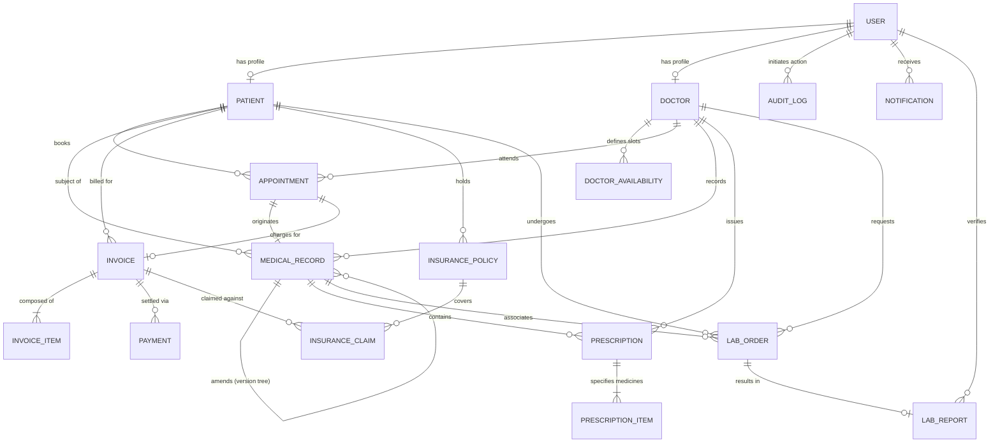

# MediCare — Entity-Relationship (ER) Diagram

This document illustrates the relational structure and foreign-key topology of the MediCare database.

---

## Referential Integrity & Deletion Policies

1. **`on_delete=models.PROTECT` for Clinical & Financial Entities**:
   - A `Patient` record cannot be deleted if historical `Appointment`, `MedicalRecord`, `Invoice`, or `LabOrder` entries exist.
   - A `Doctor` cannot be dropped if clinical encounters or active prescriptions reference them.
   - An `Invoice` cannot be purged if `Payment` records have been executed.
2. **`on_delete=models.CASCADE` for Pure Child Weak Entities**:
   - `DoctorAvailability` belongs strictly to its parent `Doctor`.
   - `PrescriptionItem` belongs strictly to its parent `Prescription`.
   - `InvoiceItem` belongs strictly to its parent `Invoice`.
3. **`on_delete=models.SET_NULL` for Auditing & Amendments**:
   - If a staff user account is deactivated or deleted, their referenced entries in `AuditLog` and `MedicalRecord.parent_record` preserve auditability by retaining historical IDs without breaking foreign-key cascades.
